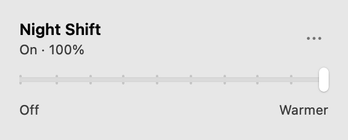

# Display Dials

A macOS menu bar app for controlling Night Shift with one warmth slider.
Move fully left to turn it off; move right to turn it on and adjust its warmth.



## Install

[Download DisplayDials.dmg](https://github.com/vitalyterenin/display-dials/releases/latest/download/DisplayDials.dmg)

Requires an **Apple Silicon Mac with macOS 13 or later** and available Night Shift
support. The permanent download always contains the current release.

1. Open the DMG and drag **Display Dials.app** onto **Applications**.
2. Eject the disk image and open the installed app. A writable location such as
   `~/Applications` also works.
3. Current builds are ad hoc signed and not notarized. If macOS blocks the first
   downloaded launch, use **System Settings > Privacy & Security > Open Anyway**.

## Use the slider

Click the sun in the menu bar to open or close the panel. A normal launch or
application reopen shows it; automatic launch at login stays quietly in the menu bar.

- **Off:** the leftmost of 10 positions disables Night Shift. A disabled system
  always appears at this endpoint, regardless of its remembered warmth.
- **Warmer:** the other nine positions enable Night Shift and select increasing
  strength. Each new tick applies immediately while dragging, before mouse release.
  Keyboard and accessibility changes also apply immediately.
- **Status:** `On · …%`, `Off`, `Unavailable`, or an error. The percentage is the
  system's normalized warmth, not calibrated kelvin or a brightness measurement.
- **More options (…):** installed version, Launch at Login, update commands and
  preferences, Usage Statistics, and Quit. The version row is informational.

The slider remains usable when Night Shift is off. It is disabled only when the
system API or Night Shift is unavailable. Hover over the status for details.
A failed change shows an error and reconciles the control with the actual system.

The app changes Night Shift globally and preserves its schedule. Settings persist
when the app quits; macOS schedules and other utilities can subsequently change
its enabled state. Turning it off leaves macOS's remembered warmth intact. Opening
or polling the panel never changes settings or rounds an external strength value.
Display Dials has no brightness adjustment, per-monitor settings or custom schedule.

## Launch at login

Use **More options (…) > Launch at Login**. The app does not register itself
without this action. Turning it off prevents future login launches and leaves the
current process running. The checkmark reflects macOS Login Items.

If approval is required, use **Allow in System Settings…** and allow the app in
**System Settings > General > Login Items & Extensions**. Names vary by macOS
version. This preference needs an app installed on a writable disk; it is disabled
inside a read-only DMG and in diagnostic/smoke modes.

## Updates

**Check for Updates…** checks immediately. Automatic checks and automatic
installation default to enabled; saved user choices take precedence. Both can be
changed in More options. Installation is disabled there while automatic checks
are off.

Sparkle checks the [signed stable feed](https://vitalyterenin.github.io/display-dials/appcast.xml)
on a four-hour schedule while the app runs. Installation can wait for quit or
permission. One signed DMG serves manual downloads and updates; there is one stable
channel and only the current DMG is retained. GitHub Releases hosts the download;
GitHub Pages hosts the signed feed. Update traffic is independent of usage
statistics and Sparkle system profiling is disabled.

The app displays its running bundle version. Source metadata in
[release.json](release.json) does not prove that a release has been published.

## Optional usage statistics

The first interactive launch/opening asks whether to share minimal usage events
through TelemetryDeck. Nothing is collected or sent before consent, and every app
feature works after declining. Closing the first prompt counts as declining.
A quiet login launch defers an undecided prompt until the panel is opened manually.

Change the choice in **More options (…) > Usage Statistics…**. Disabling clears
unsent events, cancels requests where possible and resets the random local
identifier; it cannot recall data already received by the service. See the
[complete event and storage disclosure](docs/privacy.md).

## Troubleshooting and diagnostics

Night Shift access uses the private CoreBrightness API. A future macOS change or
unsupported display configuration can make it unavailable. Other utilities and
macOS's schedule can override settings. The panel refreshes immediately after app
actions and on opening, and polls every five seconds while visible; external
changes can take several seconds to appear. Closing the panel stops this polling.
The app is intended for direct distribution and is not ready for the Mac App Store.

After building, run these read-only checks from the repository root:

```sh
app_binary="$HOME/Library/Developer/DisplayDials/Display Dials.app/Contents/MacOS/DisplayDials"
"$app_binary" --diagnostics
"$app_binary" --smoke-test
"$app_binary" --smoke-test --snapshot /tmp/display-dials-panel.png
```

These modes do not change Night Shift, start the updater, register login items or
send statistics. Snapshot writing is best-effort; check that the file exists.

Maintained by Vitaly Terenin. Report issues through
[this repository's issue tracker](https://github.com/vitalyterenin/display-dials/issues),
with the app/macOS versions, reproduction steps and read-only diagnostics.

## Build and further documentation

Building requires Swift 6+, Python 3 and Xcode or Command Line Tools. The first build
fetches the pinned Sparkle 2.10.1 dependency. From the repository root:

```sh
bash scripts/test.sh
bash scripts/build-app.sh
open "$HOME/Library/Developer/DisplayDials/Display Dials.app"
```

The default bundle is under `~/Library/Developer/DisplayDials`, and the SwiftPM cache
is under `~/Library/Developer/DisplayDials/Build`, outside Documents to avoid file
provider metadata invalidating signatures. `build-app.sh` replaces its generated
output bundle. Override locations with `DISPLAY_DIALS_OUTPUT_DIR` and
`DISPLAY_DIALS_BUILD_DIR`.

- [Implementation, test coverage and historical performance samples](docs/implementation.md)
- [Release operations and future Developer ID integration](docs/releases.md)
- [Usage statistics and privacy](docs/privacy.md)

## License

Project code and assets are licensed under [MIT](LICENSE).
Bundled components retain their [third-party licenses and notices](THIRD_PARTY_NOTICES.md).
Both files are included in the DMG and in the installed app's
`Contents/Resources/Licenses` directory, including automatic updates.
